# v0.113.1 card changes

Compared with [v0.107.1](../v0.107.1).

This page lists cards that are new, removed, or different in text, energy cost, rarity, or type. Unchanged cards are not listed. `{E}` is an energy icon inside the card text. Color tags such as gold are left out so only the words are compared.

**77** changed, **140** new, **1** removed.

## Heroes

- [Ironclad](#ironclad): 15 changed, 3 new
- [Silent](#silent): 14 changed, 4 new, 1 removed
- [Defect](#defect): 14 changed, 3 new
- [Necrobinder](#necrobinder): 11 changed, 3 new
- [Regent](#regent): 10 changed, 3 new
- [Fool](#fool): 90 new
- [Colorless](#colorless): 13 changed, 33 new
- [Quest](#quest): 1 new

## Ironclad

### Changed

#### Bloodletting

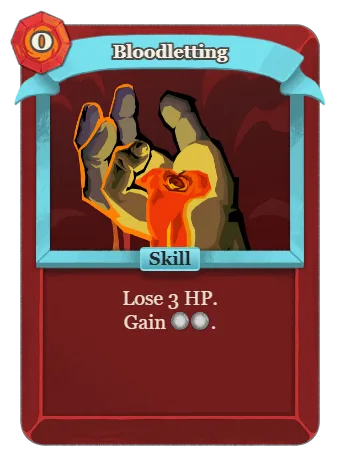

**Base**
- Rarity: Common to Uncommon

**Upgraded**
- Rarity: Common to Uncommon

#### Colossus

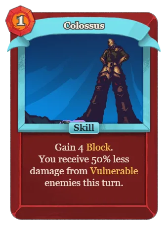

**Base**
- v0.107.1: Gain 5 Block. You receive 50% less damage from Vulnerable enemies this turn.
- v0.113.1: Gain 4 Block. You receive 50% less damage from Vulnerable enemies this turn.

**Upgraded**
- v0.107.1: Gain 8 Block. You receive 50% less damage from Vulnerable enemies this turn.
- v0.113.1: Gain 7 Block. You receive 50% less damage from Vulnerable enemies this turn.

#### Crimson Mantle

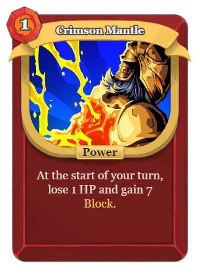

**Base**
- v0.107.1: At the start of your turn, lose 1 HP and gain 8 Block.
- v0.113.1: At the start of your turn, lose 1 HP and gain 7 Block.

#### Cruelty

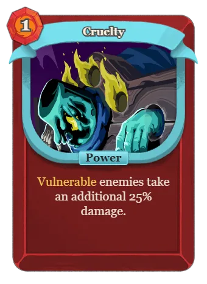

**Base**
- Rarity: Rare to Uncommon

**Upgraded**
- Rarity: Rare to Uncommon

#### Demon Form

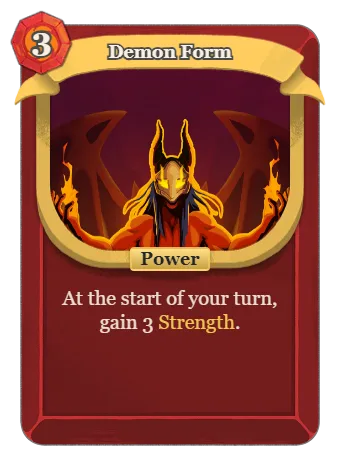

**Base**
- v0.107.1: At the start of your turn, gain 2 Strength.
- v0.113.1: At the start of your turn, gain 3 Strength.

**Upgraded**
- v0.107.1: At the start of your turn, gain 3 Strength.
- v0.113.1: At the start of your turn, gain 4 Strength.

#### Dominate

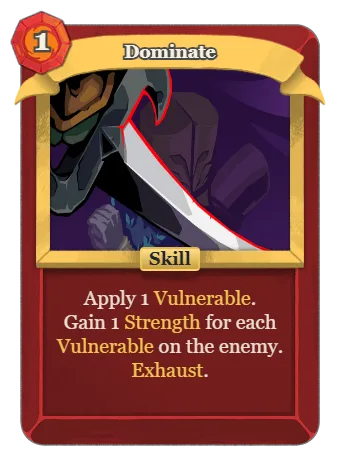

**Base**
- Rarity: Uncommon to Rare

**Upgraded**
- Rarity: Uncommon to Rare

#### Expect a Fight

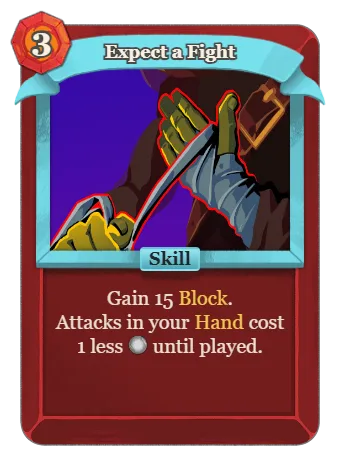

**Base**
- Cost: 2 energy to 3 energy
- v0.107.1: Gain {E} for each Attack in your Hand. You cannot gain additional {E} this turn.
- v0.113.1: Gain 15 Block. Attacks in your Hand cost 1 less {E} until played.

**Upgraded**
- Cost: 1 energy to 3 energy
- v0.107.1: Gain {E} for each Attack in your Hand. You cannot gain additional {E} this turn.
- v0.113.1: Gain 20 Block. Attacks in your Hand cost 1 less {E} until played.

#### Forgotten Ritual

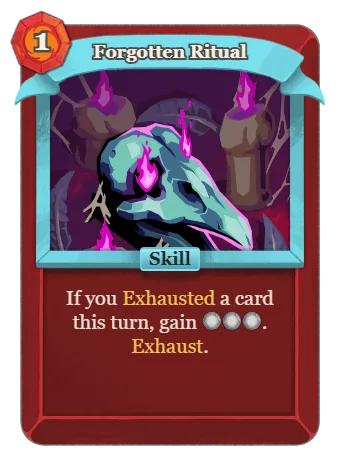

**Upgraded**
- v0.107.1: If you Exhausted a card this turn, gain 4{E}. Exhaust.
- v0.113.1: If you Exhausted a card this turn, gain {E}{E}{E}{E}. Exhaust.

#### Howl from Beyond

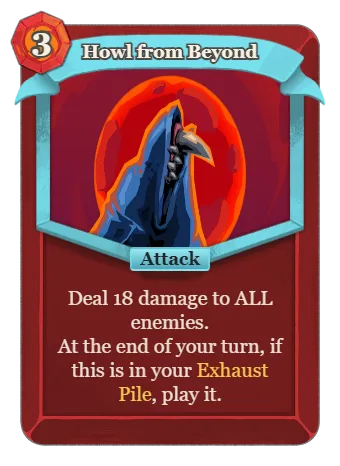

**Base**
- v0.107.1: Deal 16 damage to ALL enemies. At the end of your turn, if this is in your Exhaust Pile, play it.
- v0.113.1: Deal 18 damage to ALL enemies. At the end of your turn, if this is in your Exhaust Pile, play it.

**Upgraded**
- v0.107.1: Deal 21 damage to ALL enemies. At the end of your turn, if this is in your Exhaust Pile, play it.
- v0.113.1: Deal 24 damage to ALL enemies. At the end of your turn, if this is in your Exhaust Pile, play it.

#### Mangle

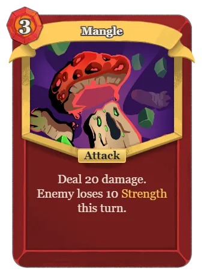

**Base**
- v0.107.1: Deal 15 damage. Enemy loses 10 Strength this turn.
- v0.113.1: Deal 20 damage. Enemy loses 10 Strength this turn.

**Upgraded**
- v0.107.1: Deal 20 damage. Enemy loses 15 Strength this turn.
- v0.113.1: Deal 26 damage. Enemy loses 15 Strength this turn.

#### Pact's End

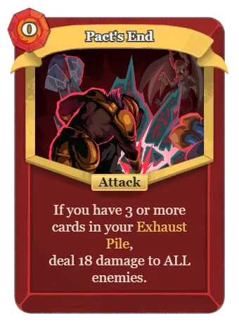

**Base**
- v0.107.1: If you have 3 or more cards in your Exhaust Pile, deal 17 damage to ALL enemies.
- v0.113.1: If you have 3 or more cards in your Exhaust Pile, deal 18 damage to ALL enemies.

**Upgraded**
- v0.107.1: If you have 3 or more cards in your Exhaust Pile, deal 23 damage to ALL enemies.
- v0.113.1: If you have 3 or more cards in your Exhaust Pile, deal 24 damage to ALL enemies.

#### Rampage

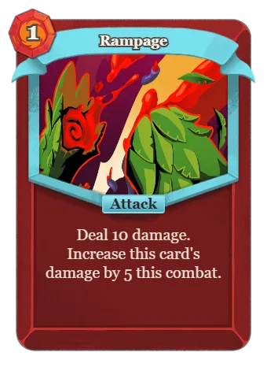

**Base**
- v0.107.1: Deal 9 damage. Increase this card's damage by 5 this combat.
- v0.113.1: Deal 10 damage. Increase this card's damage by 5 this combat.

**Upgraded**
- v0.107.1: Deal 9 damage. Increase this card's damage by 9 this combat.
- v0.113.1: Deal 10 damage. Increase this card's damage by 10 this combat.

#### Setup Strike

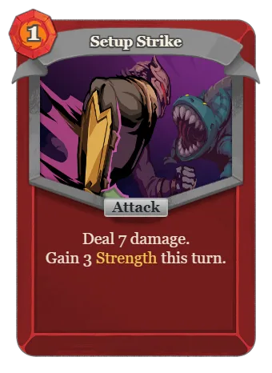

**Base**
- v0.107.1: Deal 7 damage. Gain 2 Strength this turn.
- v0.113.1: Deal 7 damage. Gain 3 Strength this turn.

**Upgraded**
- v0.107.1: Deal 9 damage. Gain 3 Strength this turn.
- v0.113.1: Deal 9 damage. Gain 4 Strength this turn.

#### Tank

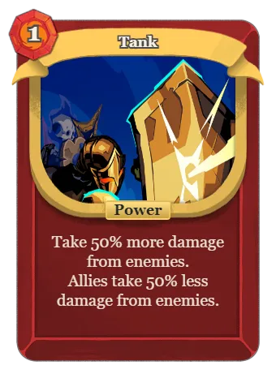

**Base**
- v0.107.1: Take double damage from enemies. Allies take half damage from enemies.
- v0.113.1: Take 50% more damage from enemies. Allies take 50% less damage from enemies.

**Upgraded**
- v0.107.1: Take double damage from enemies. Allies take half damage from enemies.
- v0.113.1: Take 50% more damage from enemies. Allies take 50% less damage from enemies.

#### Taunt

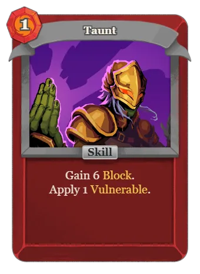

**Base**
- Rarity: Uncommon to Common
- v0.107.1: Gain 7 Block. Apply 1 Vulnerable.
- v0.113.1: Gain 6 Block. Apply 1 Vulnerable.

**Upgraded**
- Rarity: Uncommon to Common
- v0.107.1: Gain 8 Block. Apply 2 Vulnerable.
- v0.113.1: Gain 7 Block. Apply 2 Vulnerable.

### New

#### Blaze (Uncommon, Skill)

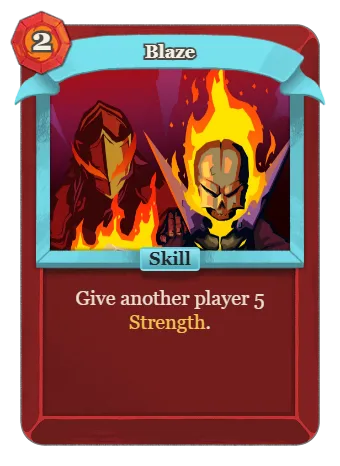

**Base**
- 2 energy. Give another player 5 Strength.

**Upgraded**
- 2 energy. Give another player 7 Strength.

#### Midnight (Rare, Attack)

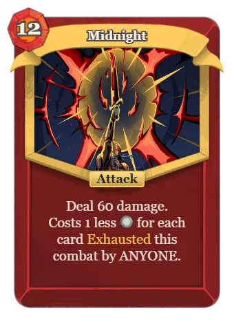

**Base**
- 12 energy. Deal 60 damage. Costs 1 less {E} for each card Exhausted this combat by ANYONE.

**Upgraded**
- 12 energy. Deal 72 damage. Costs 1 less {E} for each card Exhausted this combat by ANYONE.

#### Outrage (Uncommon, Attack)

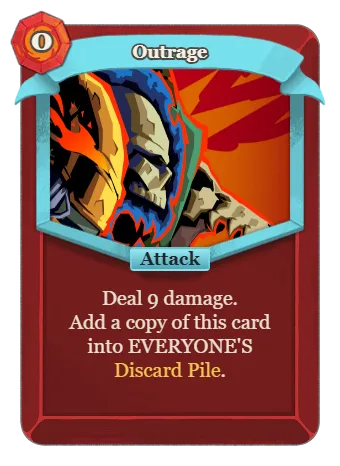

**Base**
- 0 energy. Deal 9 damage. Add a copy of this card into EVERYONE'S Discard Pile.

**Upgraded**
- 0 energy. Deal 13 damage. Add a copy of this card into EVERYONE'S Discard Pile.

## Silent

### Changed

#### Accelerant

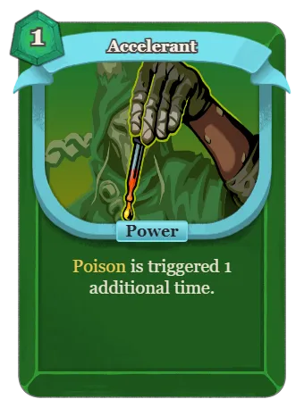

**Base**
- Rarity: Rare to Uncommon

**Upgraded**
- Rarity: Rare to Uncommon

#### Anticipate

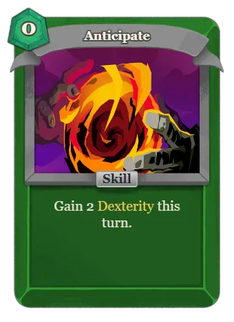

**Upgraded**
- v0.107.1: Gain 3 Dexterity this turn.
- v0.113.1: Gain 4 Dexterity this turn.

#### Echoing Slash

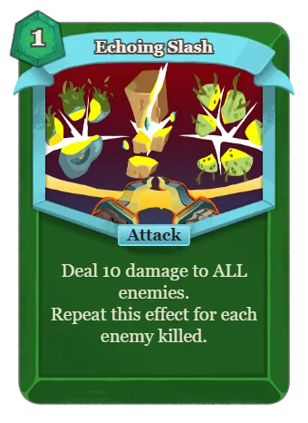

**Base**
- Rarity: Rare to Uncommon

**Upgraded**
- Rarity: Rare to Uncommon

#### Expertise

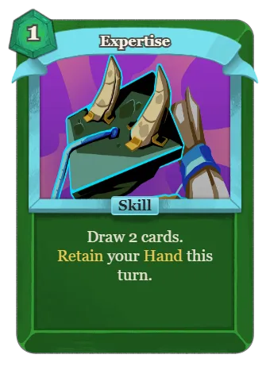

**Base**
- v0.107.1: Draw cards until you have 6 in your Hand.
- v0.113.1: Draw 2 cards. Retain your Hand this turn.

**Upgraded**
- v0.107.1: Draw cards until you have 7 in your Hand.
- v0.113.1: Draw 3 cards. Retain your Hand this turn.

#### Flanking

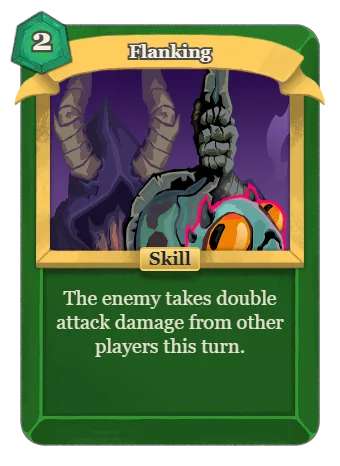

**Base**
- Rarity: Uncommon to Rare

**Upgraded**
- Rarity: Uncommon to Rare

#### Flick-Flack

**Base**
- v0.107.1: Sly. Deal 6 damage to ALL enemies.
- v0.113.1: Sly. Deal 7 damage to ALL enemies.

**Upgraded**
- v0.107.1: Sly. Deal 8 damage to ALL enemies.
- v0.113.1: Sly. Deal 9 damage to ALL enemies.

#### Haze

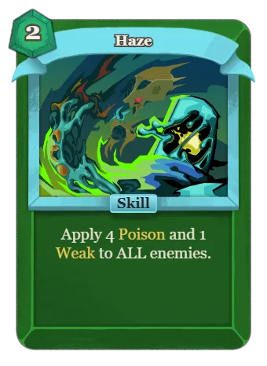

**Base**
- Cost: 3 energy to 2 energy
- v0.107.1: Sly. Apply 4 Poison to ALL enemies.
- v0.113.1: Apply 4 Poison and 1 Weak to ALL enemies.

**Upgraded**
- Cost: 3 energy to 2 energy
- v0.107.1: Sly. Apply 6 Poison to ALL enemies.
- v0.113.1: Apply 6 Poison and 2 Weak to ALL enemies.

#### Memento Mori

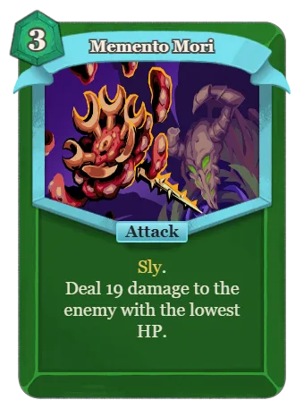

**Base**
- Cost: 1 energy to 3 energy
- v0.107.1: Deal 9 damage. Deals 4 additional damage for each card discarded this turn.
- v0.113.1: Sly. Deal 19 damage to the enemy with the lowest HP.

**Upgraded**
- Cost: 1 energy to 3 energy
- v0.107.1: Deal 11 damage. Deals 5 additional damage for each card discarded this turn.
- v0.113.1: Sly. Deal 23 damage to the enemy with the lowest HP.

#### Mirage

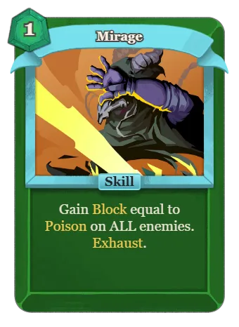

**Upgraded**
- Cost: 0 energy to 1 energy
- v0.107.1: Gain Block equal to Poison on ALL enemies. Exhaust.
- v0.113.1: Gain Block equal to Poison on ALL enemies.

#### Outbreak

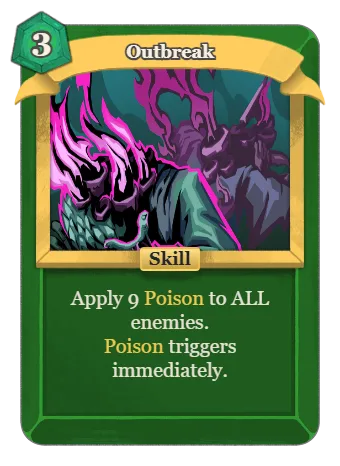

**Base**
- Cost: 1 energy to 3 energy
- Rarity: Uncommon to Rare
- Type: Power to Skill
- v0.107.1: Every 3 times you apply Poison, deal 11 damage to ALL enemies.
- v0.113.1: Apply 9 Poison to ALL enemies. Poison triggers immediately.

**Upgraded**
- Cost: 1 energy to 3 energy
- Rarity: Uncommon to Rare
- Type: Power to Skill
- v0.107.1: Every 3 times you apply Poison, deal 15 damage to ALL enemies.
- v0.113.1: Apply 12 Poison to ALL enemies. Poison triggers immediately.

#### Phantom Blades

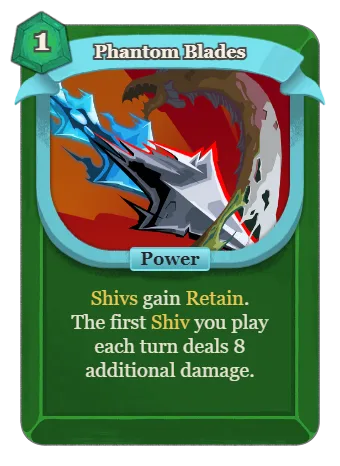

**Base**
- v0.107.1: Shivs gain Retain. The first Shiv you play each turn deals 9 additional damage.
- v0.113.1: Shivs gain Retain. The first Shiv you play each turn deals 8 additional damage.

**Upgraded**
- v0.107.1: Shivs gain Retain. The first Shiv you play each turn deals 12 additional damage.
- v0.113.1: Shivs gain Retain. The first Shiv you play each turn deals 11 additional damage.

#### Speedster

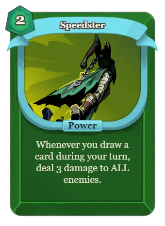

**Base**
- v0.107.1: Whenever you draw a card during your turn, deal 2 damage to ALL enemies.
- v0.113.1: Whenever you draw a card during your turn, deal 3 damage to ALL enemies.

**Upgraded**
- v0.107.1: Innate. Whenever you draw a card during your turn, deal 2 damage to ALL enemies.
- v0.113.1: Innate. Whenever you draw a card during your turn, deal 3 damage to ALL enemies.

#### Tracking

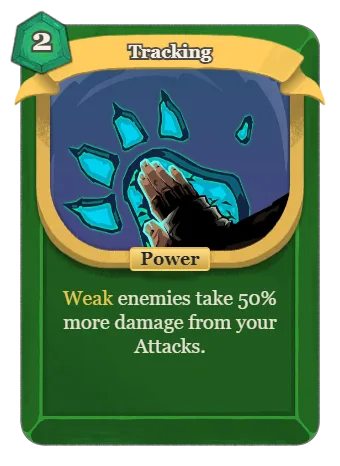

**Base**
- v0.107.1: Weak enemies take double damage from Attacks.
- v0.113.1: Weak enemies take 50% more damage from your Attacks.

**Upgraded**
- v0.107.1: Weak enemies take double damage from Attacks.
- v0.113.1: Weak enemies take 50% more damage from your Attacks.

#### Well-Laid Plans

**Base**
- Cost: 1 energy to 2 energy
- Rarity: Uncommon to Rare
- v0.107.1: At the end of your turn, Retain up to 1 card.
- v0.113.1: At the end of your turn, you no longer discard your Hand.

**Upgraded**
- Rarity: Uncommon to Rare
- v0.107.1: At the end of your turn, Retain up to 2 cards.
- v0.113.1: At the end of your turn, you no longer discard your Hand.

### New

#### Blade Symphony (Uncommon, Skill)

**Base**
- 2 energy. Add 2 Shivs to ALL players' Hands.

**Upgraded**
- 1 energy. Add 2 Shivs to ALL players' Hands.

#### Concoct (Uncommon, Skill)

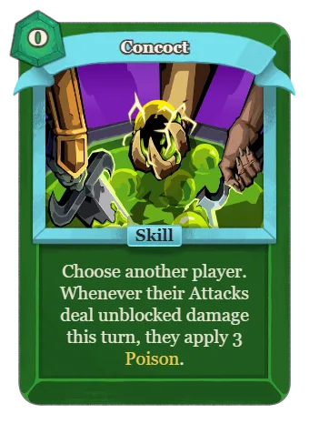

**Base**
- 0 energy. Choose another player. Whenever their Attacks deal unblocked damage this turn, they apply 3 Poison.

**Upgraded**
- 0 energy. Choose another player. Whenever their Attacks deal unblocked damage this turn, they apply 4 Poison.

#### Fade (Uncommon, Skill)

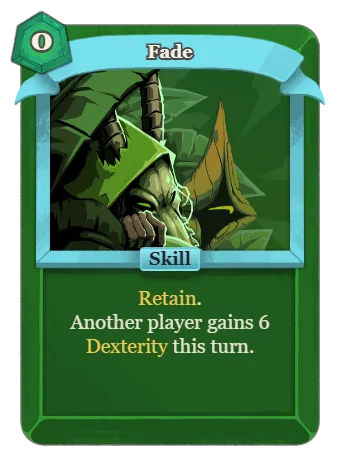

**Base**
- 0 energy. Retain. Another player gains 6 Dexterity this turn.

**Upgraded**
- 0 energy. Retain. Another player gains 9 Dexterity this turn.

#### Sidestep (Uncommon, Skill)

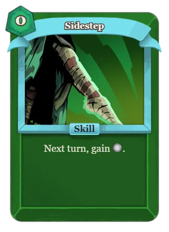

**Base**
- 0 energy. Next turn, gain {E}.

**Upgraded**
- 0 energy. Next turn, gain {E}{E}.

### Removed

#### Scare

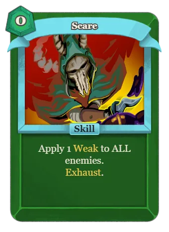

**Base**
- 0 energy. Apply 1 Weak to ALL enemies. Exhaust.

**Upgraded**
- 0 energy. Apply 1 Weak to ALL enemies.

## Defect

### Changed

#### Biased Cognition

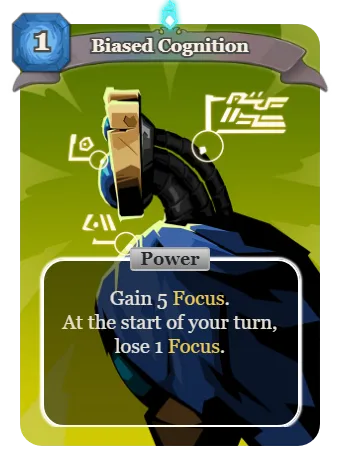

**Base**
- v0.107.1: Gain 4 Focus. At the start of your turn, lose 1 Focus.
- v0.113.1: Gain 5 Focus. At the start of your turn, lose 1 Focus.

**Upgraded**
- v0.107.1: Gain 5 Focus. At the start of your turn, lose 1 Focus.
- v0.113.1: Gain 6 Focus. At the start of your turn, lose 1 Focus.

#### Helix Drill

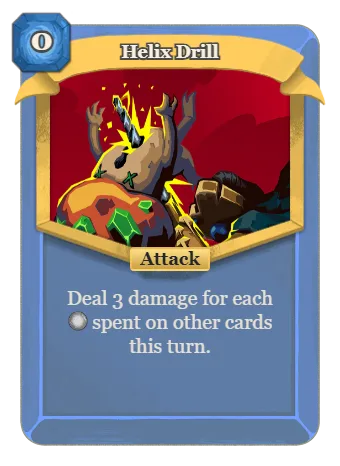

**Base**
- v0.107.1: Deal 3 damage for each {E} previously spent this turn.
- v0.113.1: Deal 3 damage for each {E} spent on other cards this turn.

**Upgraded**
- v0.107.1: Deal 5 damage for each {E} previously spent this turn.
- v0.113.1: Deal 5 damage for each {E} spent on other cards this turn.

#### Hyperbeam

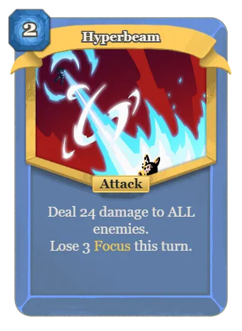

**Base**
- v0.107.1: Deal 28 damage to ALL enemies. Lose 3 Focus.
- v0.113.1: Deal 24 damage to ALL enemies. Lose 3 Focus this turn.

**Upgraded**
- v0.107.1: Deal 36 damage to ALL enemies. Lose 3 Focus.
- v0.113.1: Deal 30 damage to ALL enemies. Lose 3 Focus this turn.

#### Ignition

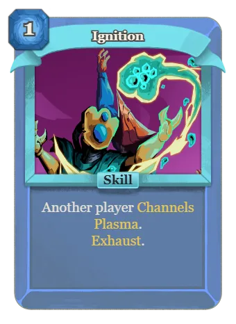

**Base**
- Rarity: Rare to Uncommon

**Upgraded**
- Rarity: Rare to Uncommon

#### Momentum Strike

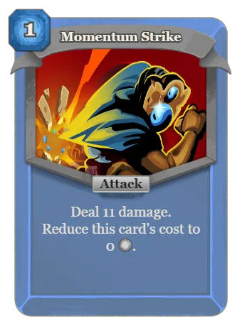

**Base**
- v0.107.1: Deal 10 damage. Reduce this card's cost to 0 {E}.
- v0.113.1: Deal 11 damage. Reduce this card's cost to 0 {E}.

**Upgraded**
- v0.107.1: Deal 13 damage. Reduce this card's cost to 0 {E}.
- v0.113.1: Deal 15 damage. Reduce this card's cost to 0 {E}.

#### Null

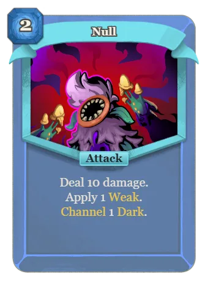

**Base**
- v0.107.1: Deal 10 damage. Apply 2 Weak. Channel 1 Dark.
- v0.113.1: Deal 10 damage. Apply 1 Weak. Channel 1 Dark.

**Upgraded**
- v0.107.1: Deal 13 damage. Apply 3 Weak. Channel 1 Dark.
- v0.113.1: Deal 13 damage. Apply 2 Weak. Channel 1 Dark.

#### Refract

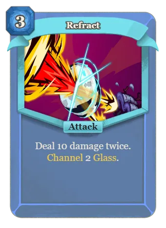

**Base**
- v0.107.1: Deal 9 damage twice. Channel 2 Glass.
- v0.113.1: Deal 10 damage twice. Channel 2 Glass.

**Upgraded**
- v0.107.1: Deal 12 damage twice. Channel 2 Glass.
- v0.113.1: Deal 13 damage twice. Channel 2 Glass.

#### Rocket Punch

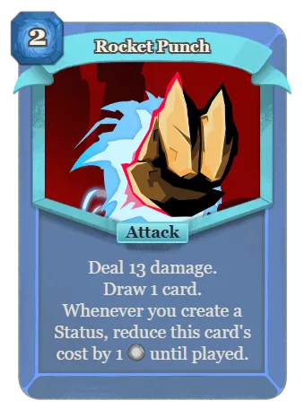

**Base**
- v0.107.1: Deal 13 damage. Draw 1 card. Whenever you create a Status, reduce this card's cost to 0 {E} until played.
- v0.113.1: Deal 13 damage. Draw 1 card. Whenever you create a Status, reduce this card's cost by 1 {E} until played.

**Upgraded**
- v0.107.1: Deal 14 damage. Draw 2 cards. Whenever you create a Status, reduce this card's cost to 0 {E} until played.
- v0.113.1: Deal 14 damage. Draw 2 cards. Whenever you create a Status, reduce this card's cost by 1 {E} until played.

#### Shatter

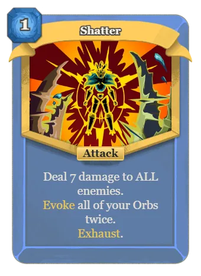

**Base**
- v0.107.1: Deal 7 damage to ALL enemies. Evoke all of your Orbs twice.
- v0.113.1: Deal 7 damage to ALL enemies. Evoke all of your Orbs twice. Exhaust.

**Upgraded**
- v0.107.1: Deal 11 damage to ALL enemies. Evoke all of your Orbs twice.
- v0.113.1: Deal 11 damage to ALL enemies. Evoke all of your Orbs twice. Exhaust.

#### Sunder

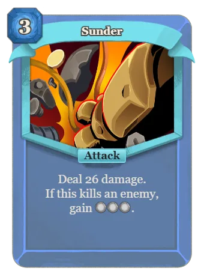

**Base**
- v0.107.1: Deal 24 damage. If this kills an enemy, gain {E}{E}{E}.
- v0.113.1: Deal 26 damage. If this kills an enemy, gain {E}{E}{E}.

**Upgraded**
- v0.107.1: Deal 32 damage. If this kills an enemy, gain {E}{E}{E}.
- v0.113.1: Deal 34 damage. If this kills an enemy, gain {E}{E}{E}.

#### Supercritical

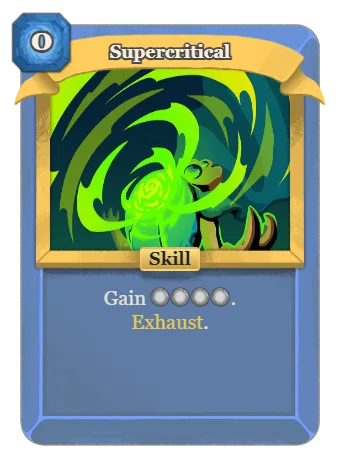

**Base**
- v0.107.1: Gain 4{E}. Exhaust.
- v0.113.1: Gain {E}{E}{E}{E}. Exhaust.

#### Synchronize

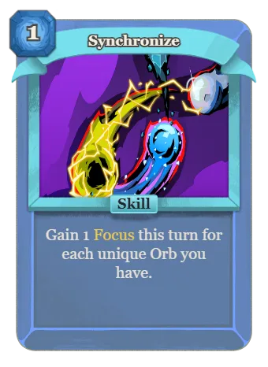

**Base**
- v0.107.1: Gain 2 Focus this turn for each unique Orb you have. Exhaust.
- v0.113.1: Gain 1 Focus this turn for each unique Orb you have.

#### Thunder

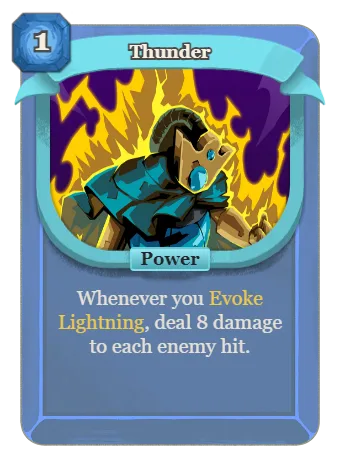

**Base**
- v0.107.1: Whenever you Evoke Lightning, deal 6 damage to each enemy hit.
- v0.113.1: Whenever you Evoke Lightning, deal 8 damage to each enemy hit.

**Upgraded**
- v0.107.1: Whenever you Evoke Lightning, deal 8 damage to each enemy hit.
- v0.113.1: Whenever you Evoke Lightning, deal 11 damage to each enemy hit.

#### Trash to Treasure

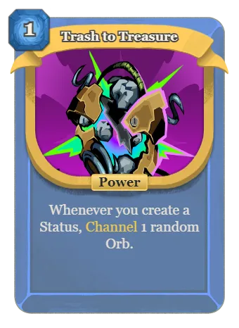

**Upgraded**
- Cost: 1 energy to 0 energy
- v0.107.1: Innate. Whenever you create a Status, Channel 1 random Orb.
- v0.113.1: Whenever you create a Status, Channel 1 random Orb.

### New

#### Hibernate (Uncommon, Skill)

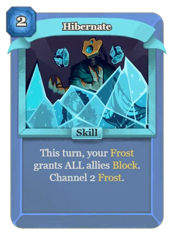

**Base**
- 2 energy. This turn, your Frost grants ALL allies Block. Channel 2 Frost.

**Upgraded**
- 2 energy. This turn, your Frost grants ALL allies Block. Channel 3 Frost.

#### Imitation Learning (Rare, Skill)

**Base**
- 1 energy. Choose another player. The next 2 times they play a Power, you play a copy of it. Exhaust.

**Upgraded**
- 1 energy. Choose another player. The next 3 times they play a Power, you play a copy of it. Exhaust.

#### One for All (Rare, Power)

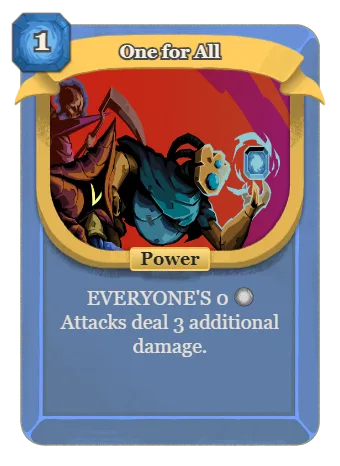

**Base**
- 1 energy. EVERYONE'S 0 {E} Attacks deal 3 additional damage.

**Upgraded**
- 1 energy. EVERYONE'S 0 {E} Attacks deal 4 additional damage.

## Necrobinder

### Changed

#### Borrowed Time

**Base**
- v0.107.1: Gain 4{E}. Cards cost an additional {E} this turn.
- v0.113.1: Gain {E}{E}{E}{E}. Cards cost an additional {E} this turn.

#### Eidolon

**Base**
- v0.107.1: Exhaust your Hand. If 9 cards were Exhausted this way, gain 1 Intangible.
- v0.113.1: Play ALL Ethereal cards in your Exhaust Pile. Exhaust.

**Upgraded**
- v0.107.1: Exhaust your Hand. If 9 cards were Exhausted this way, gain 1 Intangible.
- v0.113.1: Play ALL Ethereal cards in your Exhaust Pile. Exhaust.

#### Haunt

**Base**
- v0.107.1: Whenever you play a Soul, a random enemy loses 6 HP.
- v0.113.1: Whenever you play a Soul, a random enemy loses 7 HP.

**Upgraded**
- v0.107.1: Whenever you play a Soul, a random enemy loses 8 HP.
- v0.113.1: Whenever you play a Soul, a random enemy loses 9 HP.

#### Legion of Bone

**Base**
- v0.107.1: ALL players Summon 6. Exhaust.
- v0.113.1: ALL players Summon 6.

**Upgraded**
- v0.107.1: ALL players Summon 8. Exhaust.
- v0.113.1: ALL players Summon 8.

#### Neurosurge

**Upgraded**
- v0.107.1: Gain 4{E}. Draw 2 cards. At the start of your turn, apply 3 Doom to yourself.
- v0.113.1: Gain {E}{E}{E}{E}. Draw 2 cards. At the start of your turn, apply 3 Doom to yourself.

#### Reave

**Base**
- v0.107.1: Deal 9 damage. Add a Soul into your Draw Pile.
- v0.113.1: Deal 10 damage. Add a Soul into your Draw Pile.

**Upgraded**
- v0.107.1: Deal 11 damage. Add a Soul+ into your Draw Pile.
- v0.113.1: Deal 13 damage. Add a Soul+ into your Draw Pile.

#### Sacrifice

**Base**
- v0.107.1: Retain. If Osty is alive, he dies and you gain Block equal to double his Max HP.
- v0.113.1: Retain. If Osty is alive, he dies and you gain Block equal to triple his Max HP.

**Upgraded**
- v0.107.1: Retain. If Osty is alive, he dies and you gain Block equal to double his Max HP.
- v0.113.1: Retain. If Osty is alive, he dies and you gain Block equal to triple his Max HP.

#### Shroud

**Base**
- v0.107.1: Whenever you apply Doom, gain 2 Block.
- v0.113.1: Whenever you apply Doom, gain 3 Block.

**Upgraded**
- v0.107.1: Whenever you apply Doom, gain 3 Block.
- v0.113.1: Whenever you apply Doom, gain 4 Block.

#### Soul Storm

**Base**
- v0.107.1: Deal 9 damage. Deals 2 additional damage for each Soul in your Exhaust Pile.
- v0.113.1: Deal 9 damage. Deals 4 additional damage for each Soul in your Exhaust Pile.

**Upgraded**
- v0.107.1: Deal 9 damage. Deals 3 additional damage for each Soul in your Exhaust Pile.
- v0.113.1: Deal 9 damage. Deals 6 additional damage for each Soul in your Exhaust Pile.

#### The Scythe

**Base**
- v0.107.1: Deal 13 damage. Permanently increase this card's damage by 4. Exhaust.
- v0.113.1: Deal 13 damage. Permanently increase this card's damage by 5. Exhaust.

**Upgraded**
- v0.107.1: Deal 13 damage. Permanently increase this card's damage by 5. Exhaust.
- v0.113.1: Deal 13 damage. Permanently increase this card's damage by 7. Exhaust.

#### Time's Up

**Base**
- v0.107.1: Deal damage equal to the enemy's Doom. Exhaust.
- v0.113.1: Deal damage equal to the enemy's Doom.

**Upgraded**
- v0.107.1: Retain. Deal damage equal to the enemy's Doom. Exhaust.
- v0.113.1: Retain. Deal damage equal to the enemy's Doom.

### New

#### Cacophony (Rare, Power)

**Base**
- 2 energy. Every 33 cards drawn by ALL players, deal 66 damage to a random enemy.

**Upgraded**
- 2 energy. Every 33 cards drawn by ALL players, deal 99 damage to a random enemy.

#### Soulbound (Uncommon, Power)

**Base**
- 1 energy. Choose an ally. Whenever you create a Soul, add a Soul to their Draw Pile.

**Upgraded**
- 1 energy. Innate. Choose an ally. Whenever you create a Soul, add a Soul to their Draw Pile.

#### Underworld (Uncommon, Skill)

**Base**
- 2 energy. Whenever other players deal attack damage this turn, apply that much Doom. Exhaust.

**Upgraded**
- 2 energy. Whenever other players deal attack damage this turn, apply that much Doom.

## Regent

### Changed

#### Collision Course

**Base**
- v0.107.1: Deal 11 damage. Add a Debris into your Hand.
- v0.113.1: Deal 10 damage. Add a Debris into your Hand.

**Upgraded**
- v0.107.1: Deal 15 damage. Add a Debris into your Hand.
- v0.113.1: Deal 14 damage. Add a Debris into your Hand.

#### Crush Under

**Base**
- v0.107.1: Deal 7 damage to ALL enemies. All enemies lose 1 Strength this turn.
- v0.113.1: Deal 8 damage to ALL enemies. All enemies lose 1 Strength this turn.

**Upgraded**
- v0.107.1: Deal 8 damage to ALL enemies. All enemies lose 2 Strength this turn.
- v0.113.1: Deal 9 damage to ALL enemies. All enemies lose 2 Strength this turn.

#### Devastate

**Base**
- v0.107.1: Deal 30 damage.
- v0.113.1: Deal 35 damage.

**Upgraded**
- v0.107.1: Deal 40 damage.
- v0.113.1: Deal 45 damage.

#### Guiding Star

**Base**
- v0.107.1: Deal 12 damage. Draw 2 cards.
- v0.113.1: Deal 12 damage. Next turn, draw 2 cards.

**Upgraded**
- v0.107.1: Deal 13 damage. Draw 3 cards.
- v0.113.1: Deal 13 damage. Next turn, draw 3 cards.

#### Knockout Blow

**Base**
- v0.107.1: Deal 30 damage. If this kills an enemy, gain ★★★★★.
- v0.113.1: Deal 30 damage. If this kills an enemy, gain 5★.

**Upgraded**
- v0.107.1: Deal 38 damage. If this kills an enemy, gain ★★★★★.
- v0.113.1: Deal 38 damage. If this kills an enemy, gain 5★.

#### Orbit

**Base**
- v0.107.1: Every 4{E} you spend, gain {E}.
- v0.113.1: Every {E}{E}{E}{E} you spend, gain {E}.

**Upgraded**
- v0.107.1: Every 4{E} you spend, gain {E}.
- v0.113.1: Every {E}{E}{E}{E} you spend, gain {E}.

#### Pillar of Creation

**Base**
- v0.107.1: Whenever you create a card, gain 3 Block.
- v0.113.1: Whenever you create a card, gain 2 Block.

**Upgraded**
- v0.107.1: Whenever you create a card, gain 4 Block.
- v0.113.1: Whenever you create a card, gain 3 Block.

#### Refine Blade

**Base**
- v0.107.1: Forge 9. Next turn, gain {E}.
- v0.113.1: Forge 8. Next turn, gain {E}.

**Upgraded**
- v0.107.1: Forge 13. Next turn, gain {E}.
- v0.113.1: Forge 12. Next turn, gain {E}.

#### Spoils of Battle

**Base**
- v0.107.1: Forge 5. Draw 2 cards.
- v0.113.1: Forge 6. Draw 2 cards.

**Upgraded**
- v0.107.1: Forge 8. Draw 2 cards.
- v0.113.1: Forge 9. Draw 2 cards.

#### Terraforming

**Base**
- v0.107.1: Gain 6 Vigor.
- v0.113.1: Gain 7 Vigor.

**Upgraded**
- v0.107.1: Gain 8 Vigor.
- v0.113.1: Gain 10 Vigor.

### New

#### Constellation (Uncommon, Skill)

**Base**
- 0 energy. Another player draws 1 card, gains {E}, and gains 9 Block.

**Upgraded**
- 0 energy. Another player draws 1 card, gains {E}, and gains 12 Block.

#### Plot (Uncommon, Skill)

**Base**
- 1 energy. Next turn, ALL players draw 2 cards.

**Upgraded**
- 1 energy. Next turn, ALL players draw 3 cards.

#### Tutor (Rare, Skill)

**Base**
- 1 energy. Another player chooses a card in their Draw Pile to add into their Hand.

**Upgraded**
- 0 energy. Another player chooses a card in their Draw Pile to add into their Hand.

## Fool

### New

#### All Is Well (Uncommon, Power)

**Base**
- 1 energy. Whenever you create a Sadness, gain 4 Block.

**Upgraded**
- 1 energy. Whenever you create a Sadness, gain 5 Block.

#### Anguish (Uncommon, Attack)

**Base**
- 1 energy. Deal 6 damage. Deals 6 additional damage for each Sadness you have created this combat.

**Upgraded**
- 1 energy. Deal 7 damage. Deals 7 additional damage for each Sadness you have created this combat.

#### Archery (Uncommon, Power)

**Base**
- 1 energy. At the start of your turn, gain 4 Aim.

**Upgraded**
- 1 energy. At the start of your turn, gain 5 Aim.

#### Arrow Stab (Common, Attack)

**Base**
- 1 energy. Deal 9 damage. If you have an Arrow, put a card that can Shoot from your Discard Pile into your Hand.

**Upgraded**
- 1 energy. Deal 12 damage. If you have an Arrow, put a card that can Shoot from your Discard Pile into your Hand.

#### Blossom Shot (Uncommon, Attack)

**Base**
- 2 energy. Shoot an Arrow to deal 11 damage and gain Stretch equal to the damage dealt.

**Upgraded**
- 2 energy. Shoot an Arrow to deal 14 damage and gain Stretch equal to the damage dealt.

#### Blot out the Sky (Uncommon, Skill)

**Base**
- 1 energy. Add a random card that can Shoot into your Hand. It's free to play this turn. Exhaust.

**Upgraded**
- 0 energy. Add a random card that can Shoot into your Hand. It's free to play this turn. Exhaust.

#### Bounce (Rare, Skill)

**Base**
- 1 energy. Gain 10 Stretch. At the start of your next turn, return this to your Hand.

**Upgraded**
- 1 energy. Gain 13 Stretch. At the start of your next turn, return this to your Hand.

#### Bow Smack (Common, Attack)

**Base**
- 1 energy. Deal 8 damage. If the enemy is Impaled, gain {E}.

**Upgraded**
- 1 energy. Deal 11 damage. If the enemy is Impaled, gain {E}.

#### Brace (Uncommon, Skill)

**Base**
- X energy. Gain 8 Aim X times.

**Upgraded**
- X energy. Gain 11 Aim X times.

#### Brighten Up (Rare, Skill)

**Base**
- 1 energy. Add 2 Sadness to your Hand. Add 2 Joy to your Hand. Exhaust.

**Upgraded**
- 1 energy. Add 2 Sadness to your Hand. Add 3 Joy to your Hand. Exhaust.

#### Cho Barbs (Common, Skill)

**Base**
- 1 energy. Gain 7 Block. Gain 3 Thorns this turn.

**Upgraded**
- 1 energy. Gain 9 Block. Gain 4 Thorns this turn.

#### Cho Chorus (Rare, Skill)

**Base**
- 3 energy. Gain 12 Block. Play ALL “Wah” and “Ki” cards in your Hand.

**Upgraded**
- 3 energy. Gain 15 Block. Play ALL “Wah” and “Ki” cards in your Hand.

#### Cho Firm (Common, Skill)

**Base**
- 1 energy. Gain 6 Block. If you have an Arrow, gain Block an additional time.

**Upgraded**
- 1 energy. Gain 8 Block. If you have an Arrow, gain Block an additional time.

#### Cho Ki (Uncommon, Skill)

**Base**
- 1 energy. Gain 8 Block. Regain any spent Stretch.

**Upgraded**
- 1 energy. Gain 11 Block. Regain any spent Stretch.

#### Cho Limbs (Uncommon, Skill)

**Base**
- 2 energy. Gain 5 Block twice. Costs 2 less {E} if you have a Wah Melody or Ki Melody.

**Upgraded**
- 2 energy. Gain 7 Block twice. Costs 2 less {E} if you have a Wah Melody or Ki Melody.

#### Cho Ready (Common, Skill)

**Base**
- 1 energy. Gain 8 Block. Gain 3 Aim.

**Upgraded**
- 1 energy. Gain 11 Block. Gain 5 Aim.

#### Coda (Rare, Attack)

**Base**
- 6 energy. Deal 40 damage. Costs 2 less {E} for each Melody you have.

**Upgraded**
- 6 energy. Deal 55 damage. Costs 2 less {E} for each Melody you have.

#### Compost (Uncommon, Power)

**Base**
- 0 energy. Whenever an enemy dies, ALL players gain {E}.

**Upgraded**
- 0 energy. Whenever an enemy dies, ALL players gain {E}{E}.

#### Covering Fire (Rare, Power)

**Base**
- 1 energy. Whenever you Shoot, allies gain 8 Block.

**Upgraded**
- 1 energy. Whenever you Shoot, allies gain 11 Block.

#### Deep Stretch (Common, Skill)

**Base**
- 1 energy. Gain 7 Stretch. Draw 1 card.

**Upgraded**
- 1 energy. Gain 10 Stretch. Draw 1 card.

#### Defend (Basic, Skill)

**Base**
- 1 energy. Gain 5 Block.

**Upgraded**
- 1 energy. Gain 8 Block.

#### Dislike You (Uncommon, Attack)

**Base**
- 1 energy. Deal 8 damage. The enemy takes 50% additional damage from Shots this turn.

**Upgraded**
- 1 energy. Deal 9 damage. The enemy takes 75% additional damage from Shots this turn.

#### Divine Shot (Ancient, Attack)

**Base**
- 0 energy. Retain. Shoot an Arrow to deal 40 damage.

**Upgraded**
- 0 energy. Retain. Shoot an Arrow to deal 50 damage.

#### Ecstasy (Rare, Power)

**Base**
- 2 energy. At the start of your turn, Transform 1 random Sadness in your Hand into Joy.

**Upgraded**
- 1 energy. At the start of your turn, Transform 1 random Sadness in your Hand into Joy.

#### Encore (Rare, Skill)

**Base**
- 0 energy. Gain {E}. Draw 2 cards. You can only play 1 more card this turn.

**Upgraded**
- 0 energy. Gain {E}. Draw 3 cards. You can only play 1 more card this turn.

#### Ennui (Rare, Power)

**Base**
- 1 energy. At the start of your turn, add 1 Sadness to your Hand and draw 2 additional cards.

**Upgraded**
- 1 energy. At the start of your turn, add 1 Sadness to your Hand and draw 3 additional cards.

#### Enrapture (Uncommon, Skill)

**Base**
- 1 energy. Give another player 6 Vigor and 6 Stretch.

**Upgraded**
- 1 energy. Give another player 9 Vigor and 9 Stretch.

#### Ensemble (Rare, Skill)

**Base**
- 3 energy. The next 4 cards played by other players are free to play. Exhaust.

**Upgraded**
- 3 energy. The next 5 cards played by other players are free to play. Exhaust.

#### Epic Retrieval (Uncommon, Attack)

**Base**
- 2 energy. Deal 15 damage. If this Dislodges an Arrow, gain {E}{E}{E}.

**Upgraded**
- 2 energy. Deal 20 damage. If this Dislodges an Arrow, gain {E}{E}{E}{E}.

#### Explosive Arrows (Rare, Power)

**Base**
- 1 energy. Whenever you Impale an enemy, deal 6 damage to ALL enemies.

**Upgraded**
- 1 energy. Whenever you Impale an enemy, deal 8 damage to ALL enemies.

#### Florescence (Rare, Skill)

**Base**
- 0 energy. Exhaust ALL of your cards that Shoot and create The Shot. Exhaust.

**Upgraded**
- 0 energy. Exhaust ALL of your cards that Shoot and create The Shot+. Exhaust.

#### Foolish Shot (Basic, Attack)

**Base**
- 1 energy. Shoot an Arrow to deal 15 damage.

**Upgraded**
- 1 energy. Shoot an Arrow to deal 20 damage.

#### Growth (Uncommon, Skill)

**Base**
- 1 energy. Exhaust ALL Sadness in your Hand. Gain 4 Stretch for each card Exhausted.

**Upgraded**
- 1 energy. Exhaust ALL Sadness in your Hand. Gain 6 Stretch for each card Exhausted.

#### Harmonic Shield (Uncommon, Skill)

**Base**
- 1 energy. Gain 5 Block for each Melody you have.

**Upgraded**
- 1 energy. Gain 7 Block for each Melody you have.

#### Heavy Shot (Common, Attack)

**Base**
- 2 energy. Shoot an Arrow to deal 20 damage. Aim affects this card 2 times.

**Upgraded**
- 2 energy. Shoot an Arrow to deal 25 damage. Aim affects this card 2 times.

#### Hidden Roots (Uncommon, Power)

**Base**
- 1 energy. At the start of your turn, gain 3 Stretch.

**Upgraded**
- 1 energy. At the start of your turn, gain 4 Stretch.

#### Hobbling Shot (Uncommon, Attack)

**Base**
- 1 energy. Shoot an Arrow to deal 13 damage and apply 1 Weak and Vulnerable.

**Upgraded**
- 1 energy. Shoot an Arrow to deal 14 damage and apply 2 Weak and Vulnerable.

#### Honing (Rare, Power)

**Base**
- 3 energy. Arrows deal 50% additional damage.

**Upgraded**
- 2 energy. Arrows deal 50% additional damage.

#### Jest (Common, Skill)

**Base**
- 2 energy. Gain 14 Block. Add 1 Sadness into your Hand.

**Upgraded**
- 2 energy. Gain 18 Block. Add 1 Sadness into your Hand.

#### Ki Chant (Common, Skill)

**Base**
- 1 energy. Look at the top 3 cards of your Draw Pile. Choose 1 to add to your Hand and discard the rest.

**Upgraded**
- 1 energy. Look at the top 4 cards of your Draw Pile. Choose 1 to add to your Hand and discard the rest.

#### Ki Hop (Common, Attack)

**Base**
- 1 energy. Deal 7 damage. If the enemy is Impaled, draw 2 cards.

**Upgraded**
- 1 energy. Deal 8 damage. If the enemy is Impaled, draw 3 cards.

#### Ki Rest (Uncommon, Skill)

**Base**
- 2 energy. Next turn, gain 5{E}. If you have a Wah Melody or Cho Melody, Retain your Hand this turn.

**Upgraded**
- 2 energy. Next turn, gain 6{E}. If you have a Wah Melody or Cho Melody, Retain your Hand this turn.

#### Ki Verse (Rare, Skill)

**Base**
- 1 energy. The next “Wah”, “Cho”, or “Ki” card you play this turn is played an additional time.

**Upgraded**
- 1 energy. The next 2 “Wah”, “Cho”, or “Ki” cards you play this turn are played an additional time.

#### Ki Whip (Common, Attack)

**Base**
- 1 energy. Deal 5 damage. Next turn, gain {E}{E}.

**Upgraded**
- 1 energy. Deal 6 damage. Next turn, gain {E}{E}{E}.

#### Locked In (Uncommon, Skill)

**Base**
- 1 energy. Put a card that can Shoot from your Draw Pile into your Hand.

**Upgraded**
- 0 energy. Put a card that can Shoot from your Draw Pile into your Hand.

#### Lost Lute (Ancient, Power)

**Base**
- 3 energy. Whenever you gain a Melody, play the top card of your Draw Pile.

**Upgraded**
- 2 energy. Whenever you gain a Melody, play the top card of your Draw Pile.

#### Lullaby (Rare, Power)

**Base**
- 0 energy. When you gain every Melody, gain 20 Block.

**Upgraded**
- 0 energy. Innate. When you gain every Melody, gain 20 Block.

#### Melodic Shot (Rare, Attack)

**Base**
- 1 energy. Shoot an Arrow to deal 12 damage. Hits an additional time for each Melody you have.

**Upgraded**
- 0 energy. Shoot an Arrow to deal 13 damage. Hits an additional time for each Melody you have.

#### Motif (Uncommon, Power)

**Base**
- 2 energy. Whenever you gain a Melody, draw 1 card.

**Upgraded**
- 1 energy. Whenever you gain a Melody, draw 1 card.

#### Mourning Blow (Common, Attack)

**Base**
- 0 energy. Deal 10 damage. Transform this into Sadness and return it to your Hand.

**Upgraded**
- 0 energy. Deal 15 damage. Transform this into Sadness and return it to your Hand.

#### Mythic Form (Rare, Power)

**Base**
- 3 energy. At the start of your turn, add a random Tarot card into your Hand.

**Upgraded**
- 3 energy. At the start of your turn, add a random Upgraded Tarot card into your Hand.

#### Nail (Rare, Attack)

**Base**
- 2 energy. If the enemy is Impaled, Deal 20 damage and apply 2 Weak and Vulnerable.

**Upgraded**
- 2 energy. If the enemy is Impaled, Deal 25 damage and apply 3 Weak and Vulnerable.

#### Nock (Common, Skill)

**Base**
- 0 energy. Gain 5 Aim.

**Upgraded**
- 0 energy. Gain 7 Aim.

#### Punch of Joy (Uncommon, Attack)

**Base**
- 2 energy. Deal 13 damage. Transform 1 random Sadness in your Hand into Joy.

**Upgraded**
- 2 energy. Deal 17 damage. Transform 1 random Sadness in your Hand into Joy.

#### Quick Shot (Common, Attack)

**Base**
- 0 energy. Shoot an Arrow to deal 10 damage.

**Upgraded**
- 0 energy. Shoot an Arrow to deal 13 damage.

#### Quietus (Rare, Skill)

**Base**
- 1 energy. This turn, your next Shot deals double damage but the Arrow is destroyed. Exhaust.

**Upgraded**
- 1 energy. This turn, your next Shot deals triple damage but the Arrow is destroyed. Exhaust.

#### Quiver (Rare, Power)

**Base**
- 1 energy. Gain 1 additional Arrow.

**Upgraded**
- 1 energy. Gain 2 additional Arrows.

#### Rain Shot (Common, Attack)

**Base**
- 1 energy. Shoot an Arrow to deal 12 damage. Damage ALL other enemies equal to the damage dealt.

**Upgraded**
- 1 energy. Shoot an Arrow to deal 15 damage. Damage ALL other enemies equal to the damage dealt.

#### Rapid Shot (Uncommon, Attack)

**Base**
- 1 energy. Shoot an Arrow to deal 3 damage 3 times.

**Upgraded**
- 1 energy. Shoot an Arrow to deal 3 damage 4 times.

#### Recall (Common, Skill)

**Base**
- 1 energy. If the enemy is Impaled, Dislodge and put a card from your Discard Pile on top of your Draw Pile.

**Upgraded**
- 0 energy. If the enemy is Impaled, Dislodge and put a card from your Discard Pile on top of your Draw Pile.

#### Repeat Shot (Rare, Attack)

**Base**
- X energy. Shoot an Arrow to deal 15 damage X times.

**Upgraded**
- X energy. Shoot an Arrow to deal 20 damage X times.

#### Rhythm Strike (Uncommon, Attack)

**Base**
- 0 energy. Deal 4 damage. Hits an additional time for each Melody you have.

**Upgraded**
- 0 energy. Deal 5 damage. Hits an additional time for each Melody you have.

#### Rummage (Uncommon, Skill)

**Base**
- 1 energy. Draw 3 cards. Add a Sadness into your Hand.

**Upgraded**
- 1 energy. Draw 4 cards. Add a Sadness into your Hand.

#### Self Deprecate (Rare, Skill)

**Base**
- 1 energy. Add a Sadness to your Hand. Add 2 Joy to all allies' Hands.

**Upgraded**
- 1 energy. Add a Sadness to your Hand. Add 3 Joy to all allies' Hands.

#### Serrated Arrows (Uncommon, Power)

**Base**
- 1 energy. Impaled enemies take 25% more damage from your Attacks.

**Upgraded**
- 1 energy. Impaled enemies take 50% more damage from your Attacks.

#### Show Off (Rare, Skill)

**Base**
- 1 energy. Gain 5 Aim. If a non-minion enemy dies this turn, permanently increase this card's Aim by 2. Exhaust.

**Upgraded**
- 1 energy. Gain 5 Aim. If a non-minion enemy dies this turn, permanently increase this card's Aim by 3. Exhaust.

#### Simpleton (Rare, Power)

**Base**
- 2 energy. At the end of your turn, play the least expensive card in your Hand.

**Upgraded**
- 1 energy. At the end of your turn, play the least expensive card in your Hand.

#### Sky Shot (Rare, Attack)

**Base**
- 1 energy. Innate. Shoot an Arrow to deal 30 damage. Exhaust.

**Upgraded**
- 1 energy. Innate. Shoot an Arrow to deal 40 damage. Exhaust.

#### Song Path (Uncommon, Power)

**Base**
- 1 energy. Whenever you gain a Cho Melody, gain 5 Block.

**Upgraded**
- 1 energy. Whenever you gain a Cho Melody, gain 7 Block.

#### Sorrowful Strike (Common, Attack)

**Base**
- 1 energy. Deal 13 damage. Add 2 Sadness into your Hand.

**Upgraded**
- 1 energy. Deal 17 damage. Add 2 Sadness into your Hand.

#### Steady Cadence (Uncommon, Attack)

**Base**
- 1 energy. Deal 10 damage. Draw 1 card for each Melody you have.

**Upgraded**
- 1 energy. Deal 13 damage. Draw 1 card for each Melody you have.

#### Strike (Basic, Attack)

**Base**
- 1 energy. Deal 6 damage.

**Upgraded**
- 1 energy. Deal 9 damage.

#### Timber (Uncommon, Attack)

**Base**
- 3 energy. Deal 20 damage. If this kills an enemy, deal 30 damage to ALL enemies.

**Upgraded**
- 3 energy. Deal 25 damage. If this kills an enemy, deal 35 damage to ALL enemies.

#### Trick Shot (Uncommon, Attack)

**Base**
- 1 energy. Shoot an Arrow to deal 12 damage and return this card to your Hand.

**Upgraded**
- 1 energy. Shoot an Arrow to deal 15 damage and return this card to your Hand.

#### Tune (Uncommon, Power)

**Base**
- 2 energy. At the end of your turn, if you have a Ki Melody, the next card you play costs 0 {E}.

**Upgraded**
- 1 energy. At the end of your turn, if you have a Ki Melody, the next card you play costs 0 {E}.

#### Uproot (Uncommon, Skill)

**Base**
- 1 energy. If the enemy is Impaled, Dislodge and apply 3 Vulnerable.

**Upgraded**
- 1 energy. If the enemy is Impaled, Dislodge and apply 4 Vulnerable.

#### Violent Chord (Uncommon, Power)

**Base**
- 1 energy. Whenever you gain a Wah Melody, deal 9 damage to ALL enemies.

**Upgraded**
- 1 energy. Whenever you gain a Wah Melody, deal 12 damage to ALL enemies.

#### Vitriol (Uncommon, Skill)

**Base**
- 0 energy. Apply 2 Weak. Add a Sadness into your Hand.

**Upgraded**
- 0 energy. Apply 3 Weak. Add a Sadness into your Hand.

#### Wah Blast (Uncommon, Attack)

**Base**
- 2 energy. Deal 14 damage to ALL enemies. If you have a Cho Melody or Ki Melody, hits twice.

**Upgraded**
- 2 energy. Deal 18 damage to ALL enemies. If you have a Cho Melody or Ki Melody, hits twice.

#### Wah Cho (Uncommon, Attack)

**Base**
- 0 energy. Gain 3 Block. Deal 3 damage.

**Upgraded**
- 0 energy. Gain 5 Block. Deal 5 damage.

#### Wah Cho Ki (Rare, Attack)

**Base**
- 1 energy. Gain 9 Block. Deal 9 damage. Draw 1 card.

**Upgraded**
- 1 energy. Gain 12 Block. Deal 12 damage. Draw 2 cards.

#### Wah Hammer (Common, Attack)

**Base**
- 1 energy. Deal 9 damage. Deals double damage to Impaled enemies.

**Upgraded**
- 1 energy. Deal 12 damage. Deals double damage to Impaled enemies.

#### Wah Ki (Uncommon, Attack)

**Base**
- 1 energy. Deal 2 damage 2 times. Next turn, gain {E} and draw 1 card.

**Upgraded**
- 1 energy. Deal 4 damage 2 times. Next turn, gain {E} and draw 1 card.

#### Wah Sweep (Common, Attack)

**Base**
- 1 energy. Deal 8 damage to ALL enemies.

**Upgraded**
- 1 energy. Deal 11 damage to ALL enemies.

#### Wah Symphony (Rare, Attack)

**Base**
- 2 energy. Deal 6 damage to ALL enemies. Deals 4 additional damage for ALL your cards containing “Wah”, “Cho”, or “Ki”.

**Upgraded**
- 2 energy. Deal 6 damage to ALL enemies. Deals 6 additional damage for ALL your cards containing “Wah”, “Cho”, or “Ki”.

#### Wah Touch (Common, Attack)

**Base**
- 1 energy. Deal 6 damage. Apply 1 Vulnerable.

**Upgraded**
- 1 energy. Deal 8 damage. Apply 2 Vulnerable.

#### Whistling Arrows (Uncommon, Skill)

**Base**
- 0 energy. Gain 3 Block. Whenever you Shoot an Arrow, return this to your Hand from the Discard Pile.

**Upgraded**
- 0 energy. Gain 4 Block. Whenever you Shoot an Arrow, return this to your Hand from the Discard Pile.

#### Wrest (Uncommon, Skill)

**Base**
- 0 energy. If the enemy is Impaled, Dislodge and draw 2 cards.

**Upgraded**
- 0 energy. If the enemy is Impaled, Dislodge and draw 3 cards.

#### Yah! (Rare, Power)

**Base**
- 1 energy. The first time you Dislodge an Arrow each turn, gain {E}.

**Upgraded**
- 1 energy. The first time you Dislodge an Arrow each turn, gain {E}{E}.

#### Yoga (Uncommon, Skill)

**Base**
- 1 energy. ALL players gain 6 Stretch.

**Upgraded**
- 1 energy. ALL players gain 8 Stretch.

## Colorless

### Changed

#### Beacon of Hope

**Base**
- Cost: 1 energy to 2 energy

**Upgraded**
- Cost: 1 energy to 2 energy

#### Brightest Flame

**Base**
- v0.107.1: Gain {E}{E}. Draw 2 cards. Lose 1 Max HP.
- v0.113.1: Gain {E}{E}. Draw 2 cards. Lose 2 Max HP.

**Upgraded**
- v0.107.1: Gain {E}{E}{E}. Draw 3 cards. Lose 1 Max HP.
- v0.113.1: Gain {E}{E}{E}. Draw 3 cards. Lose 2 Max HP.

#### Enlightenment

**Base**
- v0.107.1: Reduce the cost of ALL cards in your Hand to 1 this turn. Exhaust.
- v0.113.1: Reduce the cost of ALL cards in your Hand to 1 this turn.

**Upgraded**
- v0.107.1: Reduce the cost of ALL cards in your Hand to 1 this combat. Exhaust.
- v0.113.1: Reduce the cost of ALL cards in your Hand to 1 this combat.

#### Fuel

**Base**
- v0.107.1: Gain {E}. Draw 1 card. Exhaust.
- v0.113.1: Gain {E}. Exhaust.

**Upgraded**
- v0.107.1: Gain {E}. Draw 2 cards. Exhaust.
- v0.113.1: Gain {E}{E}. Exhaust.

#### Giant Rock

**Base**
- v0.107.1: Deal 16 damage.
- v0.113.1: Deal 20 damage.

**Upgraded**
- v0.107.1: Deal 20 damage.
- v0.113.1: Deal 24 damage.

#### Maul

**Base**
- v0.107.1: Deal 5 damage twice. Increase the damage of ALL Maul cards by 1 this combat.
- v0.113.1: Deal 5 damage twice. Increase the damage of ALL Maul cards by 2 this combat.

**Upgraded**
- v0.107.1: Deal 6 damage twice. Increase the damage of ALL Maul cards by 2 this combat.
- v0.113.1: Deal 6 damage twice. Increase the damage of ALL Maul cards by 3 this combat.

#### Minion Dive Bomb

**Base**
- v0.107.1: Deal 13 damage. Exhaust.
- v0.113.1: Deal 11 damage. Exhaust.

**Upgraded**
- v0.107.1: Deal 16 damage. Exhaust.
- v0.113.1: Deal 13 damage. Exhaust.

#### Minion Sacrifice

**Base**
- v0.107.1: Gain 8 Block. Exhaust.
- v0.113.1: Gain 7 Block. Exhaust.

**Upgraded**
- v0.107.1: Gain 11 Block. Exhaust.
- v0.113.1: Gain 10 Block. Exhaust.

#### Relax

**Base**
- v0.107.1: Gain 15 Block. Next turn, draw 2 cards and gain {E}{E}. Exhaust.
- v0.113.1: Gain 16 Block. Next turn, draw 2 cards and gain {E}{E}. Exhaust.

**Upgraded**
- v0.107.1: Gain 17 Block. Next turn, draw 3 cards and gain {E}{E}{E}. Exhaust.
- v0.113.1: Gain 18 Block. Next turn, draw 3 cards and gain {E}{E}{E}. Exhaust.

#### Rend

**Base**
- Cost: 2 energy to 1 energy
- v0.107.1: Deal 15 damage. Deals 5 additional damage for each unique debuff on the enemy.
- v0.113.1: Deal 10 damage. Deals 5 additional damage for each unique debuff on the enemy.

**Upgraded**
- Cost: 2 energy to 1 energy
- v0.107.1: Deal 18 damage. Deals 8 additional damage for each unique debuff on the enemy.
- v0.113.1: Deal 12 damage. Deals 8 additional damage for each unique debuff on the enemy.

#### Salvo

**Base**
- Rarity: Rare to Uncommon
- v0.107.1: Deal 12 damage. Retain your Hand this turn.
- v0.113.1: Deal 10 damage. Retain your Hand this turn.

**Upgraded**
- Rarity: Rare to Uncommon
- v0.107.1: Deal 16 damage. Retain your Hand this turn.
- v0.113.1: Deal 14 damage. Retain your Hand this turn.

#### Splash

**Base**
- Rarity: Uncommon to Rare

**Upgraded**
- Rarity: Uncommon to Rare

#### Whistle

**Base**
- Cost: 3 energy to 2 energy

**Upgraded**
- Cost: 3 energy to 2 energy

### New

#### Abundance (Ancient, Skill)

**Base**
- 1 energy. Choose 1 of 3 Upgraded Powers to add into your Hand. It's free to play this turn. Exhaust.

**Upgraded**
- 0 energy. Choose 1 of 3 Upgraded Powers to add into your Hand. It's free to play this turn. Exhaust.

#### Amnesia (Status, Status)

**Base**
- no energy cost. This turn, draw 2 fewer cards and lose {E}.

#### Death (Token, Skill)

**Base**
- 0 energy. Apply 75 Doom. Exhaust.

**Upgraded**
- 0 energy. Apply 99 Doom. Exhaust.

#### Fine Dagger+5 (Event, Attack)

**Base**
- 0 energy. Deal 7 damage. Can be upgraded any number of times.

**Upgraded**
- 0 energy. Deal 37 damage. Can be upgraded any number of times.

#### God Byrd (Event, Skill)

**Base**
- 0 energy. At the start of your next turn, deal 30 damage to ALL enemies.

**Upgraded**
- 0 energy. At the start of your next turn, deal 40 damage to ALL enemies.

#### Joy (Token, Skill)

**Base**
- 0 energy. Gain {E}. Draw 1 card. Exhaust.

**Upgraded**
- 0 energy. Gain {E}{E}. Draw 1 card. Exhaust.

#### Judgement (Token, Skill)

**Base**
- 0 energy. If the enemy has 30 or less HP, set their HP to 0. Exhaust.

**Upgraded**
- 0 energy. If the enemy has 40 or less HP, set their HP to 0. Exhaust.

#### Justice (Token, Attack)

**Base**
- 0 energy. Deal 30 damage. Exhaust.

**Upgraded**
- 0 energy. Deal 35 damage. Exhaust.

#### Mighty Shield (Event, Skill)

**Base**
- 1 energy. Gain 20 Block. Add 3 Dazed into your Draw Pile.

**Upgraded**
- 1 energy. Gain 25 Block. Add 3 Dazed into your Draw Pile.

#### Mighty Weapon (Event, Attack)

**Base**
- 1 energy. Deal 25 damage to ALL enemies. Add 2 Dazed into your Draw Pile.

**Upgraded**
- 1 energy. Deal 30 damage to ALL enemies. Add 2 Dazed into your Draw Pile.

#### My Shinies (Rare, Attack)

**Base**
- 1 energy. Deal 1 damage for every 20 Gold you have.

**Upgraded**
- 1 energy. Deal 1 damage for every 10 Gold you have.

#### Sadness (Status, Status)

**Base**
- no energy cost. Unplayable. Retain.

#### Strength (Token, Skill)

**Base**
- 0 energy. Gain 4 Strength. Exhaust.

**Upgraded**
- 0 energy. Gain 5 Strength. Exhaust.

#### Temperance (Token, Skill)

**Base**
- 0 energy. Gain 30 Block. Exhaust.

**Upgraded**
- 0 energy. Gain 35 Block. Exhaust.

#### The Ball (Uncommon, Attack)

**Base**
- 1 energy. Deal 10 damage. Increase this card's damage by 10 this combat and give it to a random ally.

**Upgraded**
- 1 energy. Deal 10 damage. Increase this card's damage by 15 this combat and give it to a random ally.

#### The Chariot (Token, Attack)

**Base**
- 0 energy. Deal 25 damage to ALL enemies. Exhaust.

**Upgraded**
- 0 energy. Deal 30 damage to ALL enemies. Exhaust.

#### The Devil (Token, Skill)

**Base**
- 0 energy. Exhaust your Hand. Play the top card of your Draw Pile for each card Exhausted this way. Exhaust.

**Upgraded**
- 0 energy. Exhaust your Hand. Upgrade and play the top card of your Draw Pile for each card Exhausted this way. Exhaust.

#### The Emperor (Token, Skill)

**Base**
- 0 energy. Gain 7{E}. Exhaust.

**Upgraded**
- 0 energy. Gain 9{E}. Exhaust.

#### The Empress (Token, Skill)

**Base**
- 0 energy. Apply 3 Weak. Apply 3 Vulnerable. Exhaust.

**Upgraded**
- 0 energy. Apply 4 Weak. Apply 4 Vulnerable. Exhaust.

#### The Fool (Token, Skill)

**Base**
- 0 energy. Play 2 random cards from your Hand. Exhaust.

**Upgraded**
- 0 energy. Play 3 random cards from your Hand. Exhaust.

#### The Hanged Man (Token, Skill)

**Base**
- 0 energy. Lose 6 HP. Take an extra turn after this one. Exhaust.

**Upgraded**
- 0 energy. Lose 3 HP. Take an extra turn after this one. Exhaust.

#### The Hermit (Token, Skill)

**Base**
- 0 energy. Discard a card. Draw 2 cards. Discarded Curses are Exhausted. Exhaust.

**Upgraded**
- 0 energy. Discard a card. Draw 3 cards. Discarded Curses are Exhausted. Exhaust.

#### The Hierophant (Token, Skill)

**Base**
- 0 energy. Add 3 random Colorless cards into your Hand. They cost 1 less {E} this turn. Exhaust.

**Upgraded**
- 0 energy. Add 4 random Colorless cards into your Hand. They cost 1 less {E} this turn. Exhaust.

#### The High Priestess (Token, Skill)

**Base**
- 0 energy. Retain. Draw 4 cards. Exhaust.

**Upgraded**
- 0 energy. Retain. Draw 5 cards. Exhaust.

#### The Lovers (Token, Skill)

**Base**
- 0 energy. Fill your Hand with random cards from other characters. Exhaust.

**Upgraded**
- 0 energy. Fill your Hand with random upgraded cards from other characters. Exhaust.

#### The Magician (Token, Skill)

**Base**
- 0 energy. Gain 3 Orb Slots. Channel 3 random Orbs. Exhaust.

**Upgraded**
- 0 energy. Gain 4 Orb Slots. Channel 4 random Orbs. Exhaust.

#### The Moon (Token, Skill)

**Base**
- 0 energy. Fill your Hand with Shivs. Exhaust.

**Upgraded**
- 0 energy. Fill your Hand with Shivs+. Exhaust.

#### The Shot (Token, Attack)

**Base**
- 1 energy. Shoot an Arrow to deal 10 damage for each card Exhausted by Florescence.

**Upgraded**
- 1 energy. Shoot an Arrow to deal 13 damage for each card Exhausted by Florescence.

#### The Star (Token, Skill)

**Base**
- 0 energy. Next turn, gain {E}{E}{E} and draw 3 cards. Exhaust.

**Upgraded**
- 0 energy. Next turn, gain {E}{E}{E}{E} and draw 4 cards. Exhaust.

#### The Sun (Token, Skill)

**Base**
- 0 energy. Draw 2 cards. Gain {E}{E}. Add a Soot into your Discard Pile. Exhaust.

**Upgraded**
- 0 energy. Draw 3 cards. Gain {E}{E}{E}. Add a Soot into your Discard Pile. Exhaust.

#### The Tower (Token, Attack)

**Base**
- 0 energy. Deal 2 damage for each floor traveled. Exhaust.

**Upgraded**
- 0 energy. Deal 3 damage for each floor traveled. Exhaust.

#### The World (Token, Skill)

**Base**
- 0 energy. Put 5 random cards from your Discard Pile into your Hand. Exhaust.

**Upgraded**
- 0 energy. Put 7 random cards from your Discard Pile into your Hand. Exhaust.

#### Wheel of Fortune (Token, Skill)

**Base**
- 0 energy. Discard your Hand. Draw 7 cards. Exhaust.

**Upgraded**
- 0 energy. Discard your Hand. Draw 9 cards. Exhaust.

## Quest

### New

#### Dowsing (Quest)

**Base**
- no energy cost. Unplayable. After entering 4 more ? rooms, transforms into an Abundance.
